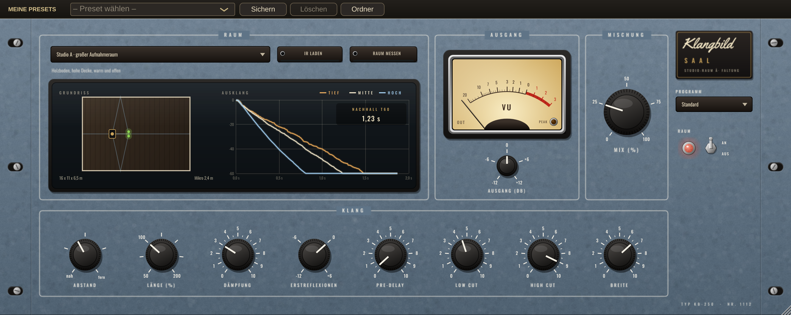

# Klangbild Saal

Studio-Raum per Faltung: berühmte Raum-*Typen* – großer Aufnahmeraum, Holzraum, Steinraum für Drums,
Hallkammer, Konzertsaal, Kirche, Treppenhaus – als echte Impulsantworten, dazu **eigene IRs laden** und
**eigene Räume messen**. Audio Unit für Logic Pro (außerdem VST3 und Standalone), gebaut mit [JUCE](https://juce.com).



## Wie es funktioniert

Die eingebauten Räume werden nicht als Algorithmus „nachgemacht“, sondern als Impulsantwort **berechnet**:
Erstreflexionen über Spiegelquellen aus den Raummaßen (Stereo-Mikrofonpaar ORTF, Nieren), dazu der diffuse
Nachhall mit eigener Nachhallzeit je Oktavband (125 Hz … 8 kHz). Danach wird – wie bei Studio-Faltungshall –
das Signal mit dieser Impulsantwort gefaltet. Die Räume sind eigene Rechnungen, keine Kopien realer Studios.

## Bedienung

| Regler | Wirkung |
|---|---|
| **Raum** | eingebauter Raum, eigene Räume aus dem Ordner „Räume“, *Impulsantwort laden …*, *Raum messen …* |
| **Abstand** | Mikrofon nah an der Quelle (trocken, präsent) bis weit hinten im Raum (mehr Raum, weichere Reflexionen) |
| **Länge** | Nachhallzeit 50 … 200 % – gilt auch für eigene IRs |
| **Dämpfung** | Höhen klingen schneller ab (Polster, Vorhänge, Publikum) |
| **Erstreflexionen** | Anteil der ersten 80 ms: mehr = näher, kantiger; weniger = weicher, entfernter |
| **Pre-Delay** | 0 … 250 ms bis zum Raum |
| **Low Cut / High Cut** | Filter nur im Raumsignal |
| **Breite** | 0 % mono · 100 % normal · 150 % extra breit |
| **Mix** | Anteil Raum (gleiche Lautheit) – **100 % für Send/Aux** |
| **Ausgang** | ±12 dB |

Das Fenster zeigt den **Grundriss** (Lautsprecher, Mikrofonpaar, erste Reflexionen) und die **Abklingkurven**
tief/mitte/hoch mit der gemessenen Nachhallzeit T60.

### Eigene Impulsantworten
*IR laden* nimmt WAV, AIFF oder FLAC (mono oder stereo, bis 8 s). Die Datei wird in den Ordner
`~/Library/Application Support/Klangbild/Räume` kopiert und steht danach immer in der Raumliste. Freie IRs gibt es
z. B. in der OpenAIR-Bibliothek der Universität York (Lizenz der jeweiligen Datei beachten); gekaufte IR-Pakete
funktionieren genauso.

### Raum messen
1. Lautsprecher dorthin stellen, wo das Instrument stehen soll, Mikrofon(e) an die Hörposition.
2. Am einfachsten mit der **Standalone-App** (Ein- und Ausgang unter *Optionen*). In Logic: Saal auf eine Audiospur
   mit dem Mikrofon als Eingang legen und Input-Monitoring einschalten.
3. Pegel wählen, *Messung starten*: 8 s Sinus-Sweep, danach 4 s Stille.

Die Impulsantwort wird per Entfaltung (exponentieller Sweep nach Farina) berechnet, ab dem Direktschall
ausgeschnitten, als WAV in „Räume“ gesichert und sofort geladen. Übersteuerung wird angezeigt.

### Presets
Standard · Gesang · Studio A weit · Drums · Steinraum · Gitarre · Holzraum · Kleiner Raum · dicht ·
Hallkammer der 60er · Konzertsaal · Kirche · Treppenhaus · Send/Aux (100 % Raum)

Eigene Einstellungen über die Leiste **Meine Presets** oben im Fenster.

### Messwerte (48 kHz)
| Raum | Soll T60 | gemessen | Rechenzeit |
|---|---|---|---|
| Studio A | 1,31 s | 1,29 s | 29 ms |
| Studio B Holzraum | 0,80 s | 0,81 s | 29 ms |
| Steinraum | 1,11 s | 1,05 s | 17 ms |
| Kleiner Raum | 0,34 s | 0,33 s | 12 ms |
| Hallkammer | 2,55 s | 2,46 s | 65 ms |
| Konzertsaal | 1,95 s | 1,92 s | 73 ms |
| Kirche | 3,85 s | 3,81 s | 66 ms |
| Treppenhaus | 2,40 s | 2,37 s | 112 ms |

- Länge 50/100/200 %: 0,57 / 1,29 / 2,52 s (Studio A)
- Links/rechts unkorreliert (−0,01), Raum AUS bitgenau
- Rechenlast Kirche (Stereo, 6 s IR): etwa 5 % eines Kerns, keine Latenz
- Messung im simulierten Raum (37 ms Latenz, Rauschen −70 dBFS): Übereinstimmung 0,91, T60 0,45 s statt 0,42 s

## Installation in Logic Pro

Am einfachsten über den [Klangbild-Installer](https://github.com/Guitoli1/KlangbildInstaller):

```bash
curl -fsSL https://raw.githubusercontent.com/Guitoli1/KlangbildInstaller/main/install.sh | bash
```

Einzeln: unter *Actions* den letzten grünen Lauf öffnen, `Klangbild-Saal-macOS` laden, `.component` nach
`~/Library/Audio/Plug-Ins/Components/` kopieren und Logic neu starten.

## Selbst bauen

```bash
cmake -B build -G Ninja -DCMAKE_BUILD_TYPE=Release
cmake --build build
```
